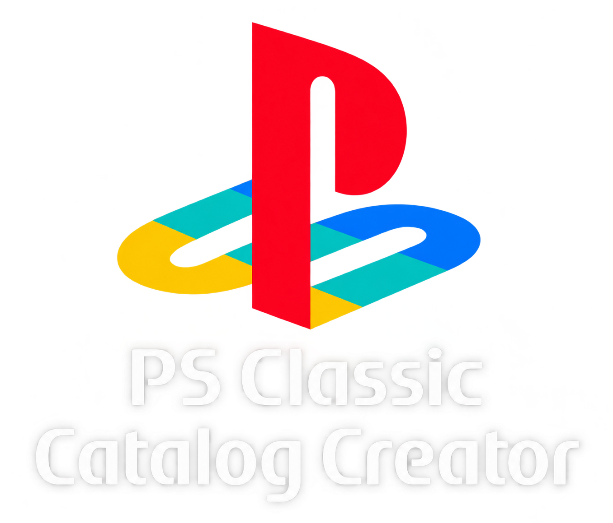

# PS Classic Store Catalog Creator

  

**Build, validate, and export PS Classic Store catalogs for PlayStation Classic games, RetroArch ROMs, and AutoBleem apps from one Windows desktop app.**

## Download

Download the latest Windows installer from the [Releases page](https://github.com/ZoneJ561/PS-Classic-Store-Catalog-Creator/releases/latest).

PS Classic Store Catalog Creator prepares catalog files without hand-writing TSV rows. Import Archive.org links or NPS PSX data, choose files and regions, review the preview, and export the feeds used by PS Classic Store on AutoBleem 2.

## Features

### Catalog Projects

- Save and reopen editable projects.
- Add, copy, remove, and batch-edit catalog rows.
- Preview and validate the TSV output before exporting.
- Reimport an updated list to add new rows without duplicating existing ones.

### Link And File Support

- Import Archive.org item links, direct file links, ZIP contents pages, and PSX/NPS TSV links.
- Choose individual files and filter imported Archive.org files by region.
- Assign a RetroArch system to selected ROMs after import.
- Fill available year, genre, developer, and other metadata; correct known arcade ROM short names.
- Add a PS1 CD box art URL from a LaunchBox game page or a direct image URL.
- Load an optional Archive.org `cookies.txt` for items your account can access.

### PS Classic Categories

- **PS1 Games** and **NPS PSX** have separate TSV exports.
- PS1 BIN/CUE game ZIPs use their own disc catalog, including multi-disc sets.
- RetroArch ROMs export one TSV for each selected system or arcade board.
- AutoBleem apps export to one app catalog.

### Updates

- The creator checks for a newer stable release when it starts.
- An update prompt shows the release changes before downloading the installer.
- **Check Updates** runs the check manually.

## What Each `.tsv` File Is For

PS Classic Store reads catalog TSVs from `System/PS Classic Store/sources/` on the USB drive. Put an exported TSV there, or host it over HTTPS and add its URL to `System/PS Classic Store/sources.txt` or a `.txt` file in `System/PS Classic Store/sources.d/`. The creator exports only categories that have rows.

### PS1 Games, NPS PSX, Disc Games, and Apps

| Catalog file | What it contains | PS Classic Store section / install behavior |
| --- | --- | --- |
| `ps-classic-games.tsv` | **PS1 Games** package links | PSX Games; converts supported PS1 packages into `Games/` |
| `ps-classic-nps-psx-games.tsv` | **PS1 NPS / NoPayStation PSX** package links | NPS PSX; converts supported PS1 packages into `Games/` |
| `ps-classic-disc-games.tsv` | PS1 BIN/CUE game ZIPs, including multi-disc sets | PSX Games; extracts a complete set into `Games/` and makes an M3U playlist for multiple discs |
| `ps-classic-apps.tsv` | AutoBleem app archives | Apps; extracts a valid app package into `Apps/<ID>/` |

`PSX_GAMES.tsv` is the original NoPayStation PSX TSV. The creator can import it, and PS Classic Store can read it as an NPS feed. When exporting NPS rows from the creator, use `ps-classic-nps-psx-games.tsv`; `PSX_GAMES.tsv` is an input name, not an extra creator export.

### RetroArch ROM Catalogs

Each selected system exports its own TSV. These feeds appear in the **ROMs** section. The Store installs console ROMs in the matching existing `RetroArch/roms/` folder. Arcade ROMs use `RetroArch/roms/Arcade/`; the selected board or maker remains visible as the catalog system. The matching RetroArch core, any required BIOS, and a compatible arcade ROM set are still needed.

| Catalog file | System shown in ROMs | Existing `RetroArch/roms/` folder |
| --- | --- | --- |
| `super-nintendo-roms.tsv` | Super Nintendo | `Nintendo - Super Nintendo Entertainment System/` |
| `sega-genesis-mega-drive-roms.tsv` | Sega Genesis / Mega Drive | `Sega - Mega Drive - Genesis/` |
| `sega-cd-roms.tsv` | Sega CD | `Sega - Mega-CD - Sega CD/` |
| `nes-roms.tsv` | NES | `Nintendo - Nintendo Entertainment System/` |
| `game-boy-roms.tsv` | Game Boy | `Nintendo - Game Boy/` |
| `game-boy-color-roms.tsv` | Game Boy Color | `Nintendo - Game Boy Color/` |
| `game-boy-advance-roms.tsv` | Game Boy Advance | `Nintendo - Game Boy Advance/` |
| `sega-master-system-roms.tsv` | Sega Master System | `Sega - Master System - Mark III/` |
| `game-gear-roms.tsv` | Game Gear | `Sega - Game Gear/` |
| `sega-32x-roms.tsv` | Sega 32X | `Sega - 32X/` |
| `turbografx-16-pc-engine-roms.tsv` | TurboGrafx-16 / PC Engine | `NEC - PC Engine - TurboGrafx 16/` |
| `capcom-play-system-1-roms.tsv` | Capcom Play System 1 | `Arcade/` |
| `capcom-play-system-2-roms.tsv` | Capcom Play System 2 | `Arcade/` |
| `capcom-play-system-3-roms.tsv` | Capcom Play System 3 | `Arcade/` |
| `snk-neo-geo-mvs-roms.tsv` | SNK Neo Geo MVS | `Arcade/` |
| `konami-roms.tsv` | Konami arcade | `Arcade/` |
| `midway-williams-roms.tsv` | Midway/Williams arcade | `Arcade/` |
| `sega-arcade-hardware-roms.tsv` | Sega arcade hardware | `Arcade/` |
| `namco-roms.tsv` | Namco arcade | `Arcade/` |
| `data-east-roms.tsv` | Data East arcade | `Arcade/` |
| `taito-roms.tsv` | Taito arcade | `Arcade/` |
| `arcade-roms.tsv` | General arcade | `Arcade/` |

## Using Archive.org Cookies

For an Archive.org item that requires your account, sign in to Archive.org in a browser on your PC. Export **Archive.org cookies only** as a Netscape-format `cookies.txt` file from a browser cookie-export tool. Your account must already have permission to download the item.

1. In Catalog Creator, click **Load cookies.txt** under **Catalog Link Import** and choose the exported file.
2. Paste or type the Archive.org item URL, click **Import Link**, then select the files to add. The loaded cookies are used for this app session and are not saved in projects or TSVs. Click **Clear** to discard them from the running app.
3. If PS Classic Store also needs those cookies to download the cataloged files, copy the same exported file to `System/PS Classic Store/private/archive-cookies.txt` on the console's USB drive. The Store sends them only to HTTPS Archive.org hosts. Remove the file from the USB when you no longer need it; it contains account credentials in plain text.

## Getting Started

1. Install the creator and start or open a saved project.
2. Import an Archive.org link or TSV, or add catalog items manually.
3. Review names, regions, links, sizes, and item types. Select ROM rows and use **Batch RetroArch System** to assign their system.
4. Save the project, then click **Export Store TSV**.
5. Put the exported TSVs in `System/PS Classic Store/sources/` or add hosted HTTPS TSV URLs to a source list as described above.

## Platform Support

| Platform | Status |
| --- | --- |
| Windows | Installer available from Releases |

## Important Note

Use PS Classic Store Catalog Creator only with content that you own, created, or have permission to download and distribute. The creator is independent of Sony, Archive.org, NoPayStation, and AutoBleem.

## About This Repository

This public repository contains the logo, documentation, and installer releases. The application source and build workflow are maintained in a separate private repository. PS Classic Store Catalog Creator is independent of PKGI Catalog Creator for PSP.
